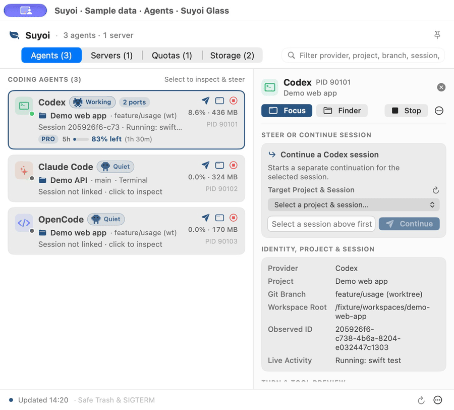
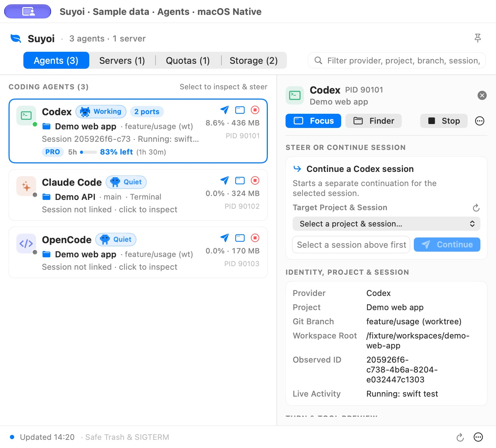
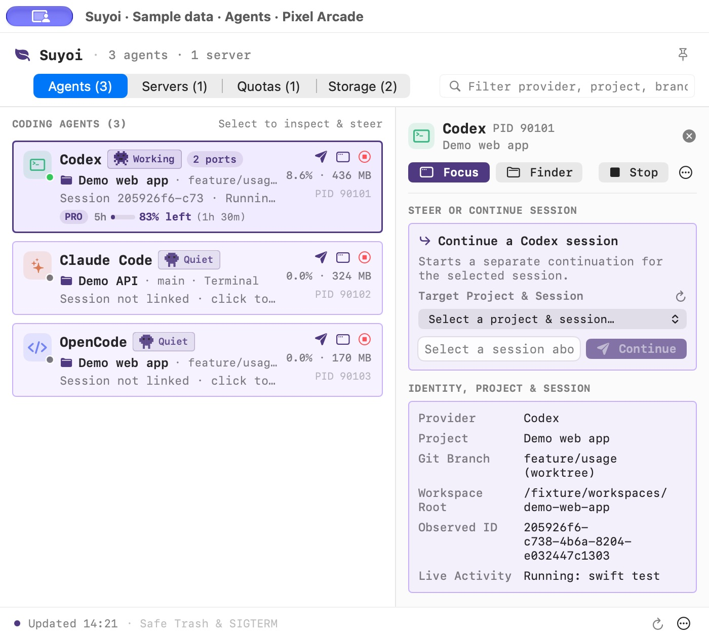
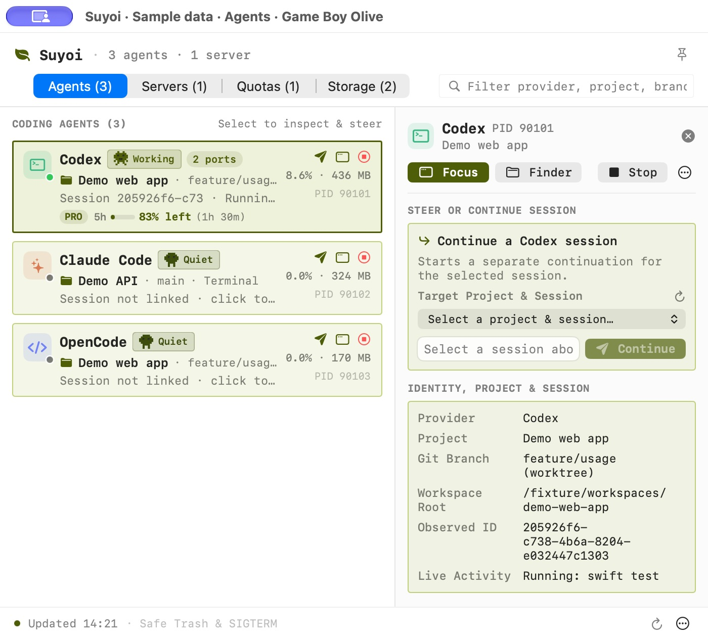

<p align="center">
  
</p>

<p align="center">
  <strong>Agents. Servers. Quotas. Storage. One place to keep track.</strong><br>
  A native macOS companion for the work happening around your editor.
</p>

<p align="center">
  <a href="https://github.com/yturkkan/suyoi/releases/latest"><strong>Download for macOS</strong></a>
  &nbsp; · &nbsp;
  <a href="docs/media/suyoi-interface-tour.mp4"><strong>Watch the 60-second tour</strong></a>
  &nbsp; · &nbsp;
  <a href="#build-from-source">Build from source</a>
</p>

<p align="center">
  <sub>macOS 14+ &nbsp; · &nbsp; Swift + SwiftUI + AppKit &nbsp; · &nbsp; No external package dependencies &nbsp; · &nbsp; <a href="LICENSE">MIT licensed</a></sub>
</p>

## Less hunting. More building.

When agents, terminals, and localhost tabs pile up, Suyoi keeps the useful context within reach.

<table>
<tr>
<td width="50%" valign="top">

### Follow your agents

See recognized coding agents, their projects, and available activity. Jump back to a verified terminal, tmux pane, or IDE target.

</td>
<td width="50%" valign="top">

### Find the project behind the port

Group related dev servers. See the branch and framework, open localhost, or copy a project-named URL.

</td>
</tr>
<tr>
<td width="50%" valign="top">

### Keep an eye on usage

See local 5-hour and 7-day token counts alongside account-wide quotas and reset times when available.

</td>
<td width="50%" valign="top">

### Review storage before cleanup

Inspect build folders, caches, merged worktrees, and old session logs. Eligible items move to macOS Trash after fresh checks.

</td>
</tr>
</table>

## See it in action

<p align="center">
  <a href="docs/media/suyoi-interface-tour.mp4">
    
  </a>
</p>

<p align="center">
  <a href="docs/media/suyoi-interface-tour.mp4"><strong>Open the full 60-second interface tour</strong></a><br>
  <sub>Native interface. Sample data. No live actions performed.</sub>
</p>

<details>
<summary>About these captures</summary>

The video, GIF, and screenshots were captured from Suyoi 0.3.6's native macOS views in an isolated sample-data preview. They show dashboard views and themes, not the Notch or Floating Companion surfaces. No live agent actions, quota requests, or cleanup are performed. The cover is brand artwork, not an application screenshot.

Explore full-resolution captures: [Agents](docs/media/suyoi-overview.jpg) · [Servers](docs/media/suyoi-servers.jpg) · [Quotas](docs/media/suyoi-quotas.jpg) · [Storage](docs/media/suyoi-storage.jpg).

</details>

## Get started

1. **[Download Suyoi.app.zip](https://github.com/yturkkan/suyoi/releases/latest)**, extract it, and move Suyoi to Applications.
2. **Open Suyoi** while a supported coding agent or dev server is running.
3. **Pick your view:** Menu Bar Popover, Notch Dynamic Island, or Floating Companion.

**macOS 14+ required.** The app is ad-hoc signed, not Developer ID signed or notarized. Review macOS security prompts before opening it. The signature checks bundle integrity; publisher trust depends on the GitHub release source.

**Live quota checks are on by default.** You can turn them off in Quotas or Settings.

<details>
<summary><strong>Updating an installed copy</strong></summary>

To update an installed copy, open **Settings → About Suyoi**, check for updates, and choose **Update & Relaunch**. Suyoi downloads the archive from GitHub Releases and verifies the bundle identifier, release version, code signature, and checksum when supplied. The helper waits for the running app to exit before replacing the bundle.

The repository also includes [the app bundle](build/Suyoi.app) and [a ZIP archive](build/Suyoi.app.zip).

</details>

### Build from source

Requirements: **macOS 14.0+** and **Xcode / Swift 6 Command Line Tools**.

```bash
git clone https://github.com/yturkkan/suyoi.git
cd suyoi

# Run the test suite
./scripts/swift-local.sh test

# Build the release app and ZIP archive
./scripts/build-app.sh

# Launch Suyoi
open build/Suyoi.app
```

## Make it feel like your Mac

**Three surfaces:** Menu Bar Popover · Notch Dynamic Island · Floating Companion.

**Four themes:** choose a quiet native look or give your workspace some pixel character. Click a preview to see it at full size.

<table>
<tr>
<th width="50%">Suyoi Glass</th>
<th width="50%">macOS Native</th>
</tr>
<tr>
<td><a href="docs/media/suyoi-overview.jpg"></a></td>
<td><a href="docs/media/suyoi-native.jpg"></a></td>
</tr>
<tr>
<th>Pixel Arcade</th>
<th>Game Boy Olive</th>
</tr>
<tr>
<td><a href="docs/media/suyoi-pixel.jpg"></a></td>
<td><a href="docs/media/suyoi-olive.jpg"></a></td>
</tr>
</table>

Optional event sounds use macOS system sounds, local OpenPeon CESP `openpeon.json` packs, or the built-in retro 8-bit pack available in Settings.

## Works with your coding workflow

Recognizes **18+ coding-agent profiles**, including **Claude Code, Codex, OpenCode, Gemini CLI, Cursor Agent, GitHub Copilot, Aider, and more**.

Support varies by agent: process detection, session focus, previews, steering, and approvals have different requirements. Actions are available only when Suyoi can verify the relevant target.

<details>
<summary><strong>All recognized agents, steering, and Claude Code approvals</strong></summary>

## Agents: visibility first, actions when verified

Suyoi recognizes more than 18 coding-agent profiles, including **Claude Code, Codex, OpenCode, Gemini CLI, Cursor Agent, Windsurf, GitHub Copilot, Aider, Goose, Amp, Droid, Kiro, Antigravity CLI, Hermes Agent, Qwen Code, Kimi CLI, OpenClaw, Pi Agent, Oh My Pi, Qoder, and CodeBuddy**.

Recognition does not imply that every integration supports every action:

- **Process visibility:** Recognize native and runtime-wrapped agents and show available project, process, and activity information.
- **Turn and tool previews:** Show bounded previews when Suyoi can identify the relevant session. Availability depends on the agent and session evidence.
- **Session focus:** Jump to an associated terminal tab, `tmux` pane, or IDE workspace when Suyoi can resolve and verify a target.
- **Terminal steering:** Send an instruction to a verified Terminal or iTerm2 target.
- **Codex and OpenCode continuation:** Choose an explicit provider session and project in the composer. This launches a **separate local continuation process**, rather than typing into the existing agent process.
- **Claude Code approvals:** With the hook bridge configured, approve or deny eligible tool requests from Suyoi. Session auto-approval requires a verified process, project, and session lifetime.

For Claude Code hooks, copy the hook command from Settings and configure `SessionStart`, `SessionEnd`, and one approval event: `PreToolUse` or `PermissionRequest`.

</details>

<details>
<summary><strong>Dev server grouping and controls</strong></summary>

## Servers: find the project behind the port

Suyoi maps listening TCP ports to their owning process trees and groups related development servers. Project context can include the Git branch and recognized frameworks such as Next.js, Vite, SwiftPM, Cargo, Python, and Go.

- Open the server in your browser or copy its URL.
- Use project-named `http://<project>.localhost:<port>` URLs.
- See uptime and stale/idle badges where available.
- Stop a verified process group with SIGTERM. Force Stop is an explicit separate action.

</details>

<details>
<summary><strong>Local token counts and account-wide quotas</strong></summary>

## Quotas: local usage and account limits, separately

Local rolling token counters cover **5-hour** and **7-day** windows. Account-wide quota utilization and reset times appear alongside them when available; they measure different things.

Live checks use existing local CLI credentials in memory for supported providers, including Codex, Claude, and Gemini. **Live quota checks are enabled by default** and can be disabled from Quotas or Settings. Provider support, local credentials, and available telemetry determine what Suyoi can display. Missing data is shown as unavailable.

</details>

<details>
<summary><strong>Storage eligibility, Trash, and Put Back</strong></summary>

## Storage: inspect, review, then move to Trash

Scan workspace build artifacts, allowlisted developer caches, merged secondary Git worktrees, and aged session logs.

- Review eligibility and the reasons an item is blocked.
- Recheck an individual item after its state changes.
- Move eligible items to **macOS Trash** after a fresh safety check.
- Use **Put Back** when Suyoi can verify the moved item and the original and Trash locations.

Large model stores and environments, including HuggingFace weights, `uv`, CoreSimulator, `.venv`, and uncataloged `~/.cache/*` directories, are separated from disposable build caches and excluded from bulk cleanup.

Displayed sizes are observations, not a promise of reclaimable disk space. Cleanup and recovery still depend on the live filesystem state.

</details>

## Built with boundaries

- **Verify before acting.** Process identity and session targets are checked before supported actions.
- **Trash, with fresh checks.** Cleanup rechecks each item; higher-impact caches are excluded from bulk cleanup. Put Back is available when recovery evidence can be verified.
- **Keep data sources clear.** Local token counts and account-wide quota utilization are shown separately. Missing data is unavailable, not zero.
- **Bounded previews.** Identified session content is inspected in memory with common credential patterns redacted; Suyoi keeps no raw transcript copy or preview history.

Live quota checks and release updates contact their respective services. Safety checks have limits, including filesystem and foreground-process races described below.

<details>
<summary><strong>Safety and privacy details</strong></summary>

Suyoi verifies the target and available evidence before an action.

1. **Bounded process and session inspection.** Wrapper recognition reads the script and module tokens needed to identify an agent, skipping prompt arguments and process environment variables. Session previews read bounded portions of an identified transcript in memory and redact common credential patterns. Suyoi keeps no raw transcript copy or preview history.
2. **Process identity checks.** Before SIGTERM or an explicit SIGKILL, Suyoi re-verifies the PID, user ID, start time, and executable against the live process table to avoid signaling a reused PID.
3. **Process-tree boundaries.** Server grouping respects interactive shells, coding agents, GUI processes, and project boundaries.
4. **Fresh checks before Trash.** Suyoi collects fresh evidence for each item, including during a bulk operation. Worktree cleanup blocks ignored or untracked local files and unverifiable Git status. Session log retention requires a fresh, complete process sample and clear open-file evidence. The final Trash operation uses a path, so a change can still occur between the last check and the move.
5. **Manual handling for higher-impact caches.** Large model stores, environments, and uncataloged caches are excluded from bulk cleanup.
6. **Verified steering targets.** Terminal and iTerm2 delivery checks live process identity, controlling TTY, and sole foreground ownership. Foreground ownership can change before the Apple Event arrives. Codex and OpenCode continuation requires explicit session selection and starts a separate process.
7. **Bounded hook approvals.** The Claude Code bridge stores only the fields needed to show and resolve the request. Session auto-approval is limited to a verified process, project, and session lifetime.

Live quota checks and release updates contact their respective services. See [the architecture document](docs/ARCHITECTURE.md) for implementation details and limitations.

</details>

[Read the architecture and safety invariants](docs/ARCHITECTURE.md)

## For developers

<details>
<summary><strong>Read-only JSON inspection CLI</strong></summary>

The app's embedded executable provides JSON inspection commands for scripts and diagnostics:

```bash
build/Suyoi.app/Contents/MacOS/Suyoi --help
build/Suyoi.app/Contents/MacOS/Suyoi --snapshot
build/Suyoi.app/Contents/MacOS/Suyoi --quotas
build/Suyoi.app/Contents/MacOS/Suyoi --scan-cleanup
build/Suyoi.app/Contents/MacOS/Suyoi --scan-cleanup "/path/to/workspace"
build/Suyoi.app/Contents/MacOS/Suyoi --agent-storage
```

| Command | Output |
| --- | --- |
| `--snapshot` | Current-user processes, detected agents, grouped servers, project context, and listening TCP ports. |
| `--quotas` | Local rolling token consumption and rate-limit window metadata. No live quota request. |
| `--scan-cleanup [path]` | Build artifacts and allowlisted caches, including safety assessments. |
| `--agent-storage` | Discovered developer and AI cache directories with byte measurements, without safety evaluation. |

These inspection commands do not terminate processes or move files. The separate `--hook-bridge` command participates in the Claude Code approval flow and is not an inspection command.

</details>

<details>
<summary><strong>First-workspace checklist</strong></summary>

1. Start a supported coding agent or local development server.
2. Open Suyoi and inspect **Agents** or **Servers**. Select an agent and use **Focus** to return to its associated session when available.
3. Check **Quotas** for usage data and its source. Live checks are on by default; turn them off with **Live: ON** in Quotas or in Settings.
4. Open **Storage** and review **Safety Preview** before moving anything to Trash.
5. In Settings, choose your display surface and theme.

</details>

<details>
<summary><strong>Repository layout</strong></summary>

```text
Sources/
├── SuyoiCore/        # Process inspection, quotas, cleanup safety, steering
└── SuyoiApp/         # AppKit surfaces, SwiftUI views, CLI entrypoint
Tests/
└── SuyoiCoreTests/   # Unit and fixture tests
Resources/           # App icon and artwork
scripts/
├── build-app.sh     # Release bundle and archive builder
└── swift-local.sh   # Toolchain wrapper
docs/
├── ARCHITECTURE.md   # System design and safety invariants
└── media/            # Sample-data interface tour and screenshots
```

</details>

## Feedback welcome

Found a bug or have an idea? [Open an issue](https://github.com/yturkkan/suyoi/issues). If Suyoi fits your workflow, a star helps other developers find it.

## License and author

Suyoi is an independent clean-room implementation released under the [MIT License](LICENSE). Engineering patterns informed by open-source macOS utilities are documented in [THIRD_PARTY_NOTICES.md](THIRD_PARTY_NOTICES.md).

Created by **Y. Türkkan** · [GitHub](https://github.com/yturkkan) · [X](https://x.com/yturkkan) · [LinkedIn](https://www.linkedin.com/in/yturkkan)

© 2026 Y. Türkkan
