<p align="center">
  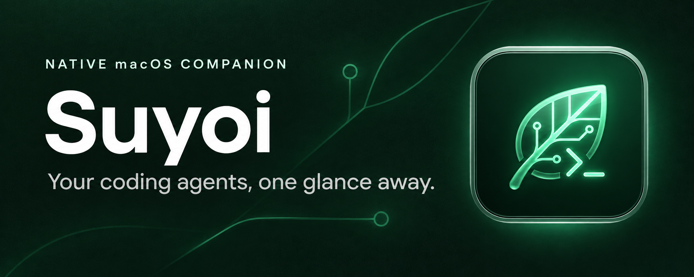
</p>

<p align="center">
  <strong>Agents. Live Chat. Servers. Quotas. Storage. One native macOS companion.</strong><br>
  A lightweight control surface for the coding agents, dev servers, quotas, and caches around your editor.
</p>

<p align="center">
  <a href="https://github.com/yturkkan/suyoi/releases/latest"><strong>Download for macOS (v0.6.0)</strong></a>
  &nbsp; · &nbsp;
  <a href="#get-started"><strong>One-line install</strong></a>
  &nbsp; · &nbsp;
  <a href="#see-it-in-action"><strong>See it in action</strong></a>
  &nbsp; · &nbsp;
  <a href="#build-from-source"><strong>Build from source</strong></a>
</p>

<p align="center">
  <sub>macOS 14+ &nbsp; · &nbsp; Swift 6 + SwiftUI + AppKit &nbsp; · &nbsp; Menu Bar, Detachable Window, Notch & Floating Companion &nbsp; · &nbsp; Zero external dependencies &nbsp; · &nbsp; <a href="LICENSE">MIT licensed</a></sub>
</p>

## Less hunting. More building.

When agents, terminals, localhost ports, and build caches pile up, Suyoi keeps verified controls and live workspace context one click away.

<table>
<tr>
<td width="50%" valign="top">

### Unified Agent Hub & Steering

Browse live and historical sessions across Claude Code, Codex, Gemini CLI, OpenCode, and Cursor. Start or continue multi-turn chats, steer verified terminals (`Terminal`, `iTerm2`, `tmux`, `WezTerm`, `kitty`), answer `AskUserQuestion` prompts inline, and isolate colliding worktrees.

</td>
<td width="50%" valign="top">

### Find the project behind the port

Map listening TCP ports to owning process trees, group multi-port dev servers, open `http://<project>.localhost:<port>` URLs, and stop verified server groups cleanly.

</td>
</tr>
<tr>
<td width="50%" valign="top">

### Quotas, burn rate & headroom

View local 5-hour and 7-day rolling token counts alongside account-wide OAuth quota windows, burn-rate depletion forecasts, and headroom guidance.

</td>
<td width="50%" valign="top">

### Deep storage index & safe Trash

Scan `DerivedData`, `node_modules`, `target`, `.build`, `pnpm`/toolchain stores, `.venv`, AI caches, merged worktrees, and aged session logs — moving eligible items to macOS Trash after fresh execution-time checks, with **Put Back** recovery.

</td>
</tr>
</table>

## See it in action

<p align="center">
  <a href="docs/screenshots/01-agents-console-chat-steering.png">
    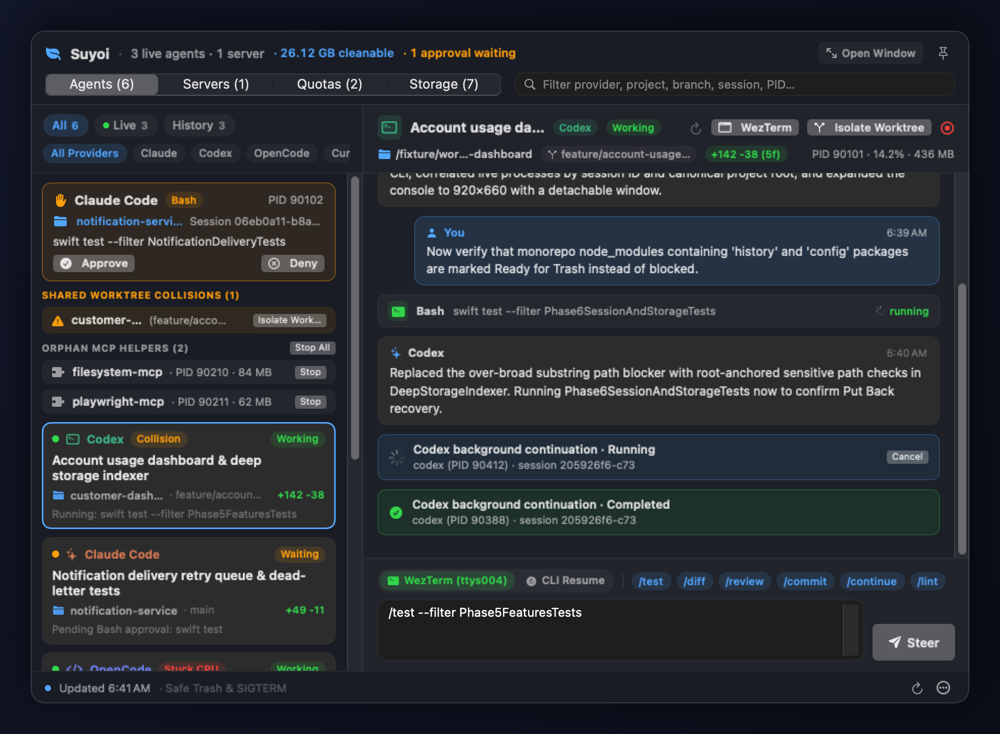
  </a><br>
  <sub><strong>Unified Agent Console:</strong> live & historical sessions, multi-turn streaming chat, hook approvals, worktree collision & diff inspection, orphan MCP cleanup, and slash-snippet steering.</sub>
</p>

<table>
<tr>
<th width="50%">Launch New Agent Conversations</th>
<th width="50%">Notch Dynamic Island & Floating Companion</th>
</tr>
<tr>
<td><a href="docs/screenshots/10-new-agent-chat-hub.png">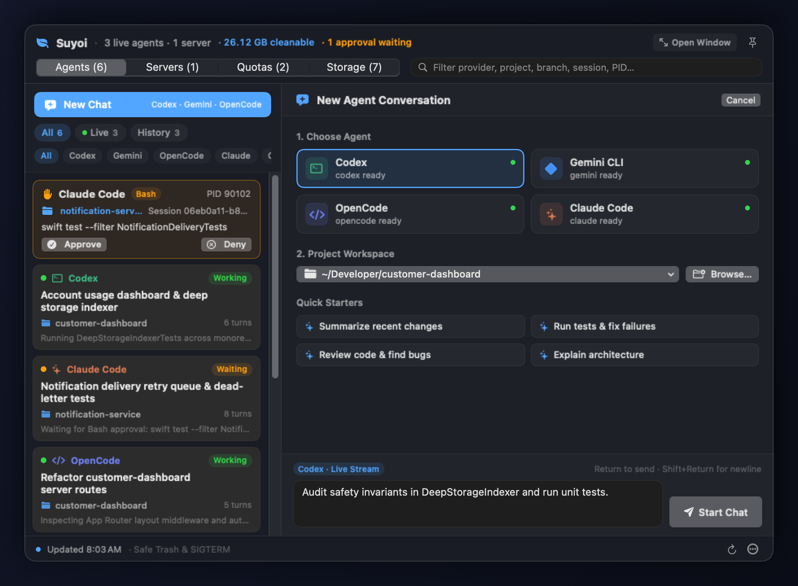</a></td>
<td><a href="docs/screenshots/03-notch-island-inline-steer-questions.png">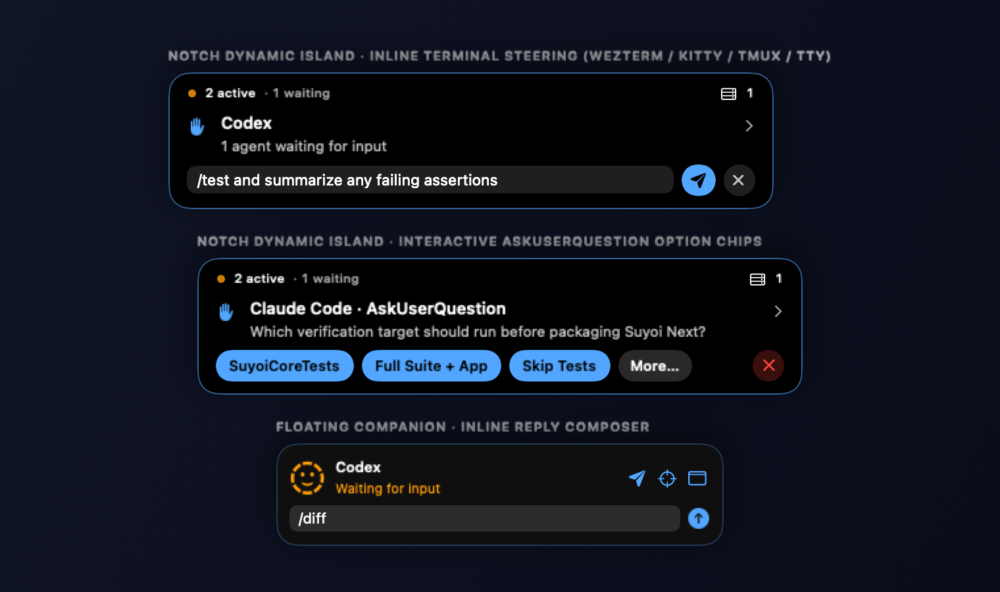</a></td>
</tr>
<tr>
<th>Deep Storage Indexer & Safe Trash</th>
<th>Quotas, Burn-Rate Forecast & Headroom</th>
</tr>
<tr>
<td><a href="docs/screenshots/02-deep-storage-indexer-cleanup.png">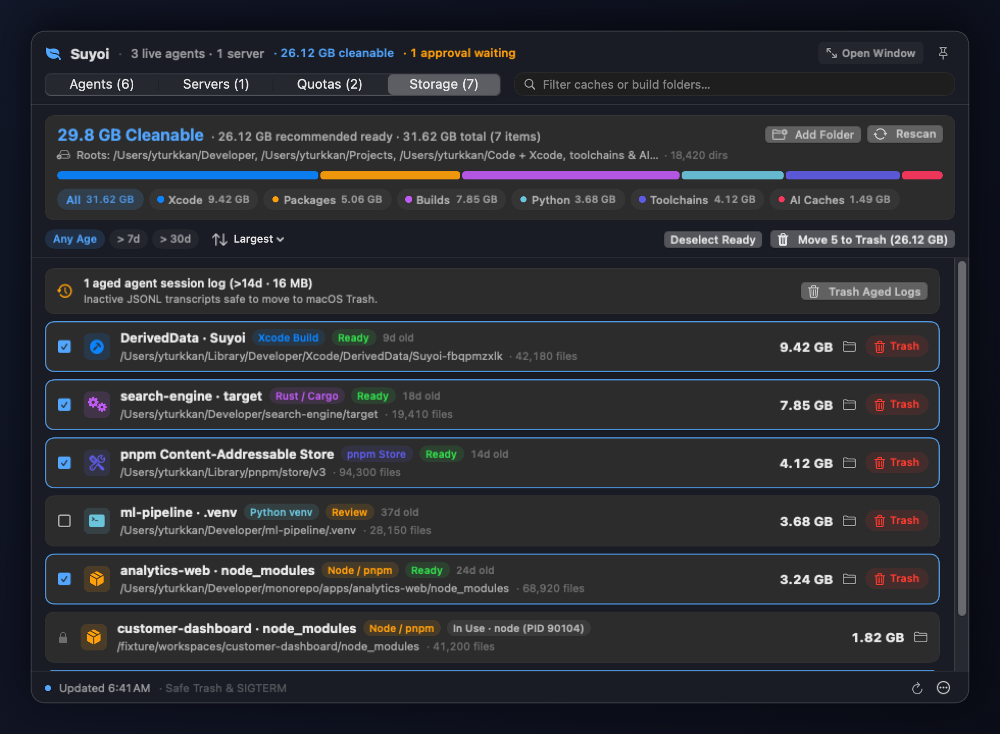</a></td>
<td><a href="docs/screenshots/04-quotas-burn-rate-forecast.png">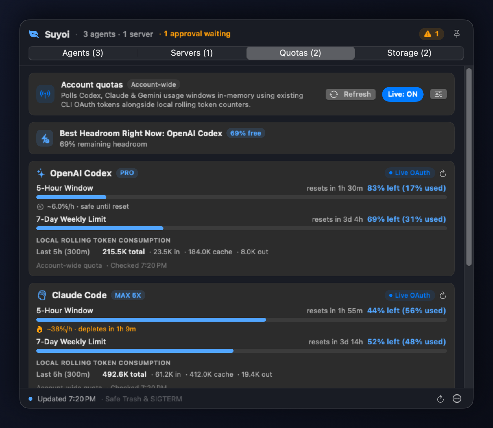</a></td>
</tr>
<tr>
<th>Dev Servers & Project Ports</th>
<th>One-Click Hooks, Read-Only Auto-Approve & Snippets</th>
</tr>
<tr>
<td><a href="docs/screenshots/07-dev-servers-ports.png">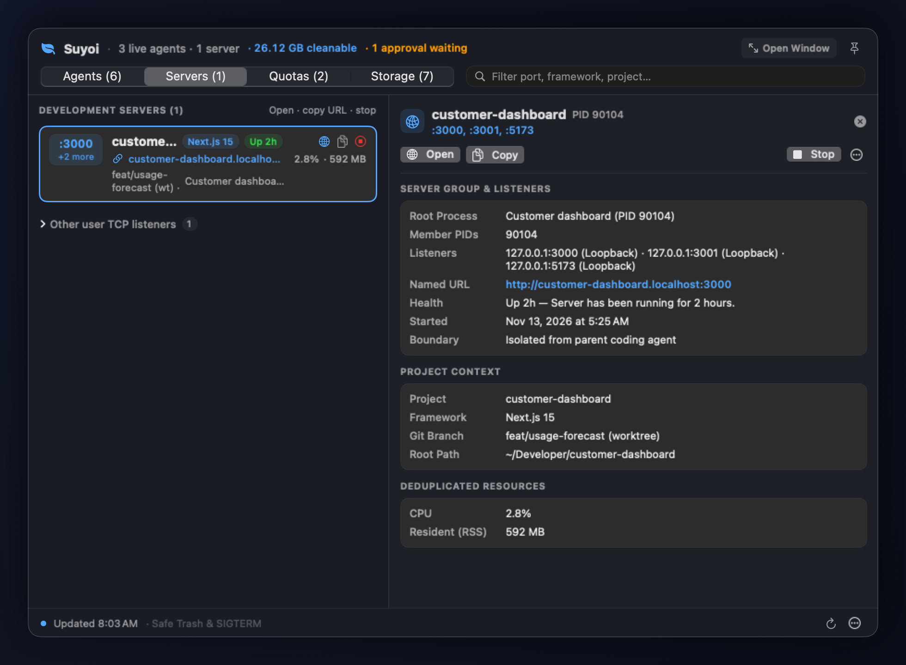</a></td>
<td><a href="docs/screenshots/05-settings-hooks-readonly-snippets.png">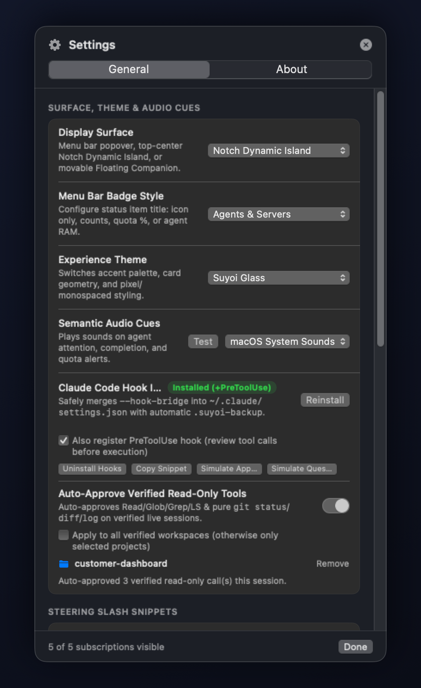</a></td>
</tr>
</table>

<details>
<summary>About these captures</summary>

All screenshots above are rendered at 2× Retina resolution (`1960×1440` for dashboard windows) directly from Suyoi's native SwiftUI and AppKit views using isolated sample data — no live processes, network requests, or cleanup actions are performed. You can also view the supplemental [60-second motion tour](docs/media/suyoi-interface-tour.mp4). The top banner is brand artwork rather than an application screenshot.

</details>

## Get started

**One-line install (verifies SHA-256 checksum & code signature, installs cleanly to `/Applications/Suyoi.app` without Gatekeeper quarantine prompts):**

```bash
curl -fsSL https://raw.githubusercontent.com/yturkkan/suyoi/main/scripts/install.sh | bash
```

Or install manually:

1. **[Download Suyoi.app.zip](https://github.com/yturkkan/suyoi/releases/latest)**, extract it, and move `Suyoi.app` to `/Applications`.
2. **Open Suyoi** while a supported coding agent or dev server is running.
3. **Pick your surface:** Menu Bar Popover, **Detachable Window** (`Open Window`, resizable 980×720 workspace), Notch Dynamic Island, or Floating Companion.

**macOS 14+ required.** Release binaries are ad-hoc signed rather than Developer ID notarized; review macOS security prompts before opening manual browser downloads, or use the verified one-line installer above. Signature checks verify bundle integrity while publisher trust depends on the GitHub Releases source.

**Live quota checks are on by default.** You can toggle them anytime from **Quotas** or **Settings**.

<details>
<summary><strong>Updating an installed copy</strong></summary>

Open **Settings → About Suyoi**, click **Check for Updates**, and choose **Update & Relaunch**. Suyoi stages the release archive from GitHub Releases and verifies its checksum, bundle identifier, normalized release version, and code signature before replacing `/Applications/Suyoi.app` and relaunching.

</details>

### Build from source

Requirements: **macOS 14.0+** and **Xcode 16 / Swift 6 Command Line Tools**.

```bash
git clone https://github.com/yturkkan/suyoi.git
cd suyoi

# Run the test suite
./scripts/swift-local.sh test

# Build Suyoi.app and Suyoi.app.zip
./scripts/build-app.sh

# Launch Suyoi
open build/Suyoi.app
```

## Make it feel like your Mac

**Four presentation modes:** Menu Bar Popover · Detachable Window · Notch Dynamic Island · Floating Companion.

**Four built-in themes:** switch between clean macOS translucency or retro pixel character. Click any preview to view full size.

<table>
<tr>
<th width="50%">Suyoi Glass</th>
<th width="50%">macOS Native</th>
</tr>
<tr>
<td><a href="docs/screenshots/01-agents-console-chat-steering.png"></a></td>
<td><a href="docs/screenshots/08-macos-native-theme.png">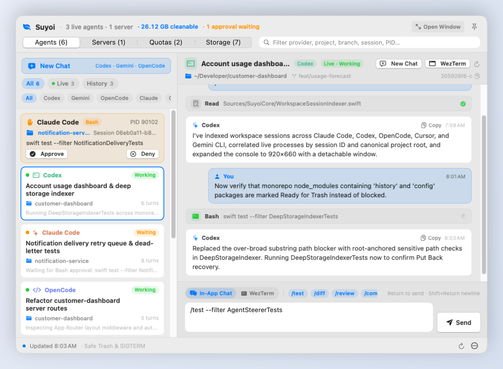</a></td>
</tr>
<tr>
<th>Pixel Arcade</th>
<th>Game Boy Olive</th>
</tr>
<tr>
<td><a href="docs/screenshots/06-pixel-arcade-theme.png">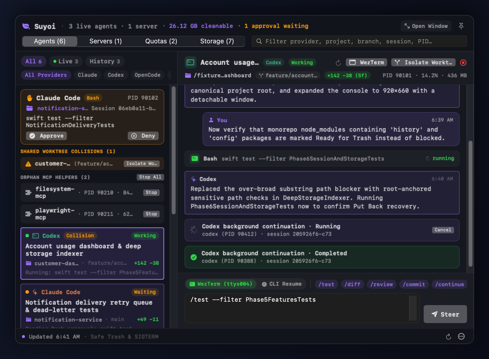</a></td>
<td><a href="docs/screenshots/09-gameboy-olive-theme.png">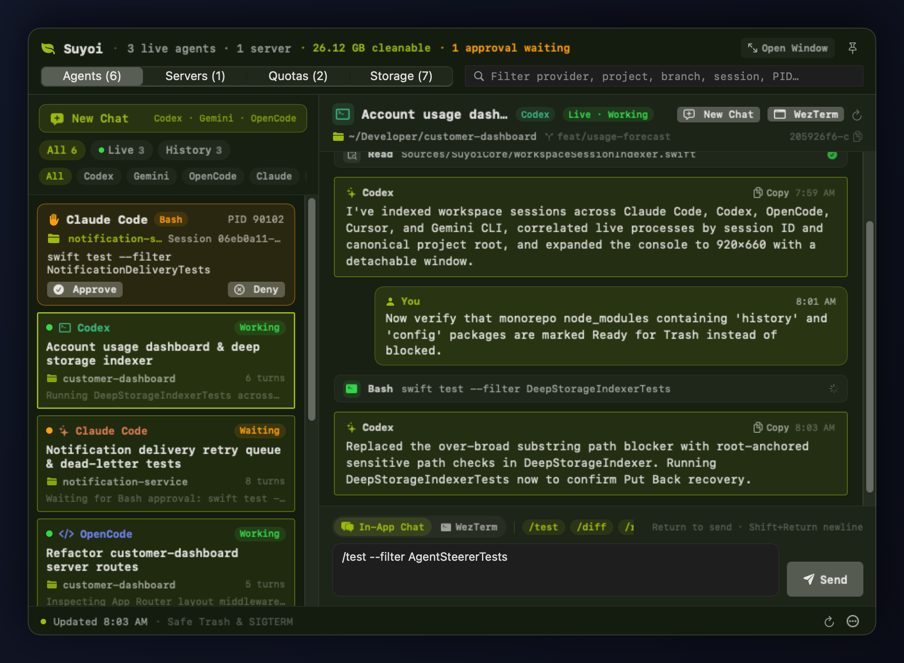</a></td>
</tr>
</table>

Optional semantic audio cues support macOS system sounds, local OpenPeon CESP `openpeon.json` sound packs, or Suyoi's built-in 8-bit chiptune synthesizer in **Settings**.

## Works with your coding workflow

Recognizes **18+ coding-agent profiles**, including **Claude Code, Codex, OpenCode, Gemini CLI, Cursor Agent, GitHub Copilot, Aider, and more**, while filtering out noisy background service daemons and desktop GUI host shells from live agent lists.

Support varies by agent: process detection, session focus, previews, streaming chat, terminal steering, and hook approvals have distinct verification requirements and activate only when Suyoi verifies the target.

<details>
<summary><strong>All recognized agents, Unified Chat Hub, steering, and Claude Code approvals</strong></summary>

### Agents: visibility first, actions when verified

Suyoi recognizes 18+ CLI profiles including **Claude Code, Codex, OpenCode, Gemini CLI, Cursor Agent, Windsurf, GitHub Copilot, Aider, Goose, Amp, Droid, Kiro, Antigravity CLI, Hermes Agent, Qwen Code, Kimi CLI, OpenClaw, Pi Agent, Oh My Pi, Qoder, and CodeBuddy**:

- **Noise-filtered live recognition:** Background service subcommands (`codex app-server`, `codex exec-server`, `opencode serve --service`, `hermes gateway`) and desktop GUI shells (`OpenCode.app`, `Codex.app`) are excluded from live agent rows while still protecting their active caches and session logs.
- **Unified Agent Hub (`AgentsConsoleView` & `WorkspaceSessionIndexer`):** Browse live and historical workspace sessions across Codex, Claude Code, OpenCode, Cursor, and Gemini CLI; filter by `All / Live / History` or provider; and launch new conversations or resume historical ones via `AgentChatStreamRunner` (`Codex`, `Gemini CLI`, `OpenCode`, `Claude Code`), refusing parallel resume against live-owned sessions.
- **Session focus (`SessionJumpRouter`):** Jump directly to the verified terminal tab, `tmux` pane, or IDE workspace.
- **Verified terminal steering (`AgentSteerer`):** Send prompts or custom slash snippets (`/test`, `/diff`, `/review`, `/commit`, custom snippets) to verified `Terminal.app`, `iTerm2`, `tmux`, `WezTerm`, or `kitty` targets — plus inline reply directly from the Notch Dynamic Island or Floating Companion.
- **One-click Claude Code hook installer & approvals:** Install `--hook-bridge` cleanly into `~/.claude/settings.json` (with automatic `.suyoi-backup`), approve or deny `Bash` / tool requests, answer `AskUserQuestion` option chips inline, and optionally auto-approve verbatim-verified read-only tools (`Read`, `Glob`, `Grep`, `LS`, and pure `git status`/`diff`/`log`) per workspace or session.
- **Workspace diagnostics:** Detect shared worktree collisions (`Isolate Worktree` creates a clean sibling worktree branch), view live Git diff summaries, inspect stuck high-CPU agents, and stop orphan MCP helper processes cleanly.

</details>

<details>
<summary><strong>Dev server grouping and controls</strong></summary>

### Servers: find the project behind the port

Suyoi maps listening TCP ports to their owning process trees (`ProcessTree`) while respecting shell, coding-agent, GUI, and project boundaries. Project context surfaces Git branch/worktree state and recognized frameworks including Next.js, Astro, Nuxt, Remix, SvelteKit, Expo, Vite, Express, SwiftPM, Cargo, Python (FastAPI/Django/Flask/Streamlit), and Go.

- Open localhost servers in your browser or copy `http://<project>.localhost:<port>` URLs.
- View process uptime, memory footprint, CPU %, and stale/idle badges.
- Stop a verified server group cleanly with `SIGTERM`, or use explicit `SIGKILL` Force Stop when required.

</details>

<details>
<summary><strong>Local token counts, account-wide quotas, and burn-rate forecast</strong></summary>

### Quotas: local usage, account limits, and headroom

Local rolling token counters cover **5-hour (`300m`)** and **7-day (`10080m`)** windows independently from account-wide OAuth quota limits:

- Live quota polling uses existing local CLI credentials in memory over ephemeral HTTPS sessions (`Codex`, `Claude`, `Gemini`) and can be disabled anytime via **Live: ON** or **Settings**.
- `QuotaBurnRateEstimator` tracks monotonic usage deltas to display hourly burn rate, projected depletion time, and **Best Headroom Right Now**.
- Unavailable provider metrics stay explicitly `Unavailable` — never fabricated as zero.

</details>

<details>
<summary><strong>Deep Storage Indexer, safety rules, Trash, and Put Back</strong></summary>

### Storage: deep index, live recheck, then move to Trash

`DeepStorageIndexer` uses bounded non-following POSIX descriptor walks (`openat`/`fstatat` with `AT_SYMLINK_NOFOLLOW`) across workspace roots (`~/Developer`, `~/Projects`, `~/Code`, or custom folders added via **Add Folder**) plus Xcode, toolchain, Python, and AI agent caches:

- Filter by category (`Xcode`, `Packages`, `Builds`, `Python`, `Toolchains`, `AI Caches`) or age (`> 7d`, `> 30d`), and inspect proportional category usage at a glance.
- Eligible `Ready` items stay separated from high-impact `Review` items (`.venv`, HuggingFace model weights, `uv`, `CoreSimulator`) and `In Use` active workspaces.
- Inspect merged secondary Git worktrees and aged session logs, recheck individual items, move eligible targets to **macOS Trash** after fresh execution-time revalidation, and restore items via **Put Back** when recovery evidence is verified.

</details>

## Built with boundaries

- **Verify before acting.** Process identity (`pid`, `uid`, `startTimeMicroseconds`, `executable`) and session/TTY ownership are re-verified at execution time.
- **Trash, with fresh checks.** Cleanup rechecks each item before moving it; high-impact environments and model stores stay manual-only; Put Back restores verified Trash moves safely.
- **Keep data sources clear.** Local rolling token counts and account-wide quota limits remain separated; missing data reports `Unavailable`, never zero.
- **Bounded previews.** Identified transcripts are read in bounded memory slices with credential redaction; Suyoi stores no raw transcript history.

<details>
<summary><strong>Safety and privacy details</strong></summary>

1. **Bounded process and session inspection.** Wrapper matching reads only the command/script tokens needed to recognize an agent (`KERN_PROCARGS2`), skipping `envp` and prompt arguments. Session previews cap reads at 64 KiB and redact common credential/token patterns before rendering.
2. **Process identity checks.** Before `SIGTERM` or explicit `SIGKILL`, Suyoi re-verifies PID, UID, start time, and executable path to prevent signaling a reused PID.
3. **Process-tree boundaries.** Server grouping stops at interactive shells, coding agents, GUI bundles, and workspace boundaries.
4. **Fresh checks before Trash.** Each item undergoes live process, open-file (`lsof`), symlink-free descendant, and `FileIdentity` (`st_dev`, `st_ino`) rechecks before `FileManager.default.trashItem`. Merged worktrees require clean Apple-signed Git status with zero ignored/untracked local files.
5. **Manual handling for higher-impact caches.** Model stores (`HuggingFace`), `.venv`, `uv`, `CoreSimulator`, and uncataloged caches are excluded from bulk Trash actions.
6. **Verified steering targets.** Terminal delivery checks live process identity, controlling TTY, and foreground ownership; CLI chat continuations refuse to resume sessions currently owned by a live running agent process.
7. **Bounded hook approvals.** `--hook-bridge` writes minimal approval metadata to a user-private spool and limits session/read-only auto-approvals to verified process, project, and session lifetimes.

See [the architecture and safety document](docs/ARCHITECTURE.md) for implementation details and invariants.

</details>

[Read the architecture and safety invariants](docs/ARCHITECTURE.md)

## For developers

<details>
<summary><strong>Read-only JSON inspection CLI</strong></summary>

The embedded executable exposes JSON inspection commands for scripts and diagnostics:

```bash
/Applications/Suyoi.app/Contents/MacOS/Suyoi --help
/Applications/Suyoi.app/Contents/MacOS/Suyoi --snapshot
/Applications/Suyoi.app/Contents/MacOS/Suyoi --quotas
/Applications/Suyoi.app/Contents/MacOS/Suyoi --scan-cleanup
/Applications/Suyoi.app/Contents/MacOS/Suyoi --scan-cleanup "/path/to/workspace"
/Applications/Suyoi.app/Contents/MacOS/Suyoi --agent-storage
```

| Command | Output |
| --- | --- |
| `--snapshot` | Current-user processes, detected agents, grouped servers, project context, and listening TCP ports. |
| `--quotas` | Local rolling token consumption and rate-limit window metadata (no live network request). |
| `--scan-cleanup [path]` | Build artifacts and allowlisted caches, including safety assessments. |
| `--agent-storage` | Discovered developer and AI cache directories with byte measurements, without safety evaluation. |

These inspection commands never terminate processes or move files. `--hook-bridge` participates strictly in the Claude Code hook protocol.

</details>

<details>
<summary><strong>Repository layout</strong></summary>

```text
Sources/
├── SuyoiCore/        # Process inspection, quotas, deep storage safety, steering, hooks
└── SuyoiApp/         # AppKit surfaces, SwiftUI views, Detached Window, CLI entrypoint
Tests/
└── SuyoiCoreTests/   # Unit and fixture test suites
Resources/            # App icon and artwork
scripts/
├── build-app.sh      # Release bundle and archive builder
├── install.sh        # SHA-256 & signature verified installer for /Applications/Suyoi.app
└── swift-local.sh    # Toolchain wrapper
docs/
├── ARCHITECTURE.md   # System design and safety invariants
├── screenshots/      # 2x Retina showcase captures rendered from Suyoi's native views
└── media/            # Brand cover artwork and interface tour video
```

</details>

## Feedback welcome

Found a bug or have an idea? [Open an issue](https://github.com/yturkkan/suyoi/issues).

## License and author

Suyoi is an independent clean-room implementation released under the [MIT License](LICENSE). Engineering patterns informed by open-source macOS utilities are documented in [THIRD_PARTY_NOTICES.md](THIRD_PARTY_NOTICES.md).

Created by **Y. Türkkan** · [GitHub](https://github.com/yturkkan) · [X](https://x.com/yturkkan) · [LinkedIn](https://www.linkedin.com/in/yturkkan)

© 2026 Y. Türkkan
